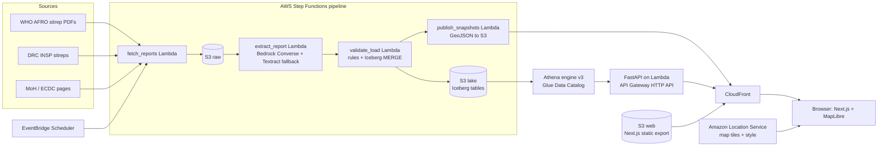

# ZoneWatch Architecture and Build Spec

Companion to `README.md`. This file is the contract between the four workstreams: data, frontend, infra and API, story and QA. If something here is wrong or blocks you, change it and tell the team.

---

## 1. System overview



Key idea: **S3 + Iceberg + Athena is the single source of truth.** The API and the precomputed snapshots are both derived from it.

---

## 2. Pipeline stages

State machine: `ZoneWatchIngest` (Standard workflow).

| # | Step | Type | Input | Output | Failure behaviour |
|---|---|---|---|---|---|
| 1 | `FetchReports` | Lambda | source config list | list of new `report_id`s, raw files in `s3://RAW/<source>/<report_id>.pdf` | Retry 3x with backoff; skip a source on persistent failure but continue |
| 2 | `ForEachReport` | Map state (max concurrency 3) | report list | per-report result | Catch and route to step 6 |
| 3 | `ExtractReport` | Lambda (timeout 5 to 10 min) | raw PDF key | `extracted/<report_id>.json` | Fall back to Textract, then to review queue |
| 4 | `ValidateAndLoad` | Lambda | extracted JSON | rows `MERGE`d into Iceberg, validation result | Hard-rule failure routes to review queue and loads nothing |
| 5 | `PublishSnapshots` | Lambda | table state | GeoJSON per `data_as_of` in `s3://LAKE/published/` | Retry |
| 6 | `ReviewQueue` | Lambda or SNS | failed report | `s3://RAW/review/<report_id>.json` with reasons | Humans fix JSON or crosswalk, then re-run the Map item |

Idempotency: every report has a `sha256`. If a report with the same hash is already `loaded`, step 1 skips it. Loads use `MERGE` on `(report_id, zone_key)`, so reruns never duplicate rows.

Trigger: EventBridge Scheduler (daily at a fixed hour) plus manual `StartExecution` from the console.

---

## 3. Data model (Iceberg on S3, via Athena)

Create database and tables once (Athena workgroup `zonewatch`, engine v3). Replace `<LAKE_BUCKET>`.

```sql
CREATE DATABASE IF NOT EXISTS zonewatch;

-- Registry of every report we have seen
CREATE TABLE zonewatch.reports (
  report_id      string,
  source         string,      -- who_afro | insp_drc | moh_ug | moh_ke | ecdc | ukhsa
  title          string,
  url            string,
  sha256         string,
  published_at   date,
  data_as_of     date,        -- parsed from document body, not the filename
  s3_raw_key     string,
  status         string,      -- fetched | extracted | validated | loaded | review
  validation     string,      -- JSON string of rule results
  ingested_at    timestamp
)
LOCATION 's3://<LAKE_BUCKET>/iceberg/reports/'
TBLPROPERTIES ('table_type'='ICEBERG', 'format'='parquet');

-- One row per health zone per report
CREATE TABLE zonewatch.zone_report (
  report_id             string,
  data_as_of            date,
  epi_year              int,
  epi_week              int,
  country               string,
  province              string,
  health_zone           string,   -- as printed in the report
  zone_key              string,   -- normalized slug, joined to boundaries via crosswalk
  cases_cum             bigint,
  deaths_cum            bigint,
  cases_new_7d          bigint,
  deaths_new_7d         bigint,
  is_unassigned         boolean,  -- true for the "not assigned to a health zone" row
  extraction_confidence double,
  source_page           int,
  validated             boolean,
  ingested_at           timestamp
)
LOCATION 's3://<LAKE_BUCKET>/iceberg/zone_report/'
TBLPROPERTIES ('table_type'='ICEBERG', 'format'='parquet');

-- National totals per country per report (includes Uganda, Kenya, Nigeria)
CREATE TABLE zonewatch.country_report (
  report_id     string,
  data_as_of    date,
  country       string,
  cases_cum     bigint,
  deaths_cum    bigint,
  source_url    string,
  ingested_at   timestamp
)
LOCATION 's3://<LAKE_BUCKET>/iceberg/country_report/'
TBLPROPERTIES ('table_type'='ICEBERG', 'format'='parquet');

-- Curated, sourced events (imports, exports, medevacs). Hand-entered by workstream D.
CREATE TABLE zonewatch.events (
  event_id      string,
  event_date    date,
  country       string,
  admin1        string,     -- county for Kenya; never finer than county
  event_type    string,     -- imported_case | exported_case | medevac | outbreak_declared | outbreak_ended
  description   string,
  source_url    string,
  ingested_at   timestamp
)
LOCATION 's3://<LAKE_BUCKET>/iceberg/events/'
TBLPROPERTIES ('table_type'='ICEBERG', 'format'='parquet');
```

Notes:
- At this data volume (thousands of rows), **do not partition**. Partitioning would add complexity for no gain.
- Load pattern (run from Lambda via Athena `StartQueryExecution`):

```sql
MERGE INTO zonewatch.zone_report t
USING zonewatch.zone_report_staging s
ON t.report_id = s.report_id AND t.zone_key = s.zone_key
WHEN MATCHED THEN UPDATE SET
  cases_cum = s.cases_cum, deaths_cum = s.deaths_cum,
  cases_new_7d = s.cases_new_7d, deaths_new_7d = s.deaths_new_7d,
  extraction_confidence = s.extraction_confidence,
  validated = s.validated, ingested_at = s.ingested_at
WHEN NOT MATCHED THEN INSERT *;
```

(Athena Iceberg `MERGE` may not support `INSERT *`. If it errors, list the columns explicitly. The staging table can be a plain Iceberg table truncated per run, or an `INSERT INTO ... VALUES` batch.)

### Time travel and snapshot queries

```sql
-- table as of a past moment
SELECT * FROM zonewatch.zone_report
FOR TIMESTAMP AS OF TIMESTAMP '2026-11-01 12:00:00 UTC';

-- table as of a specific snapshot
SELECT * FROM zonewatch.zone_report FOR VERSION AS OF 1234567890123456789;

-- list snapshots
SELECT snapshot_id, committed_at, operation
FROM "zonewatch"."zone_report$snapshots"
ORDER BY committed_at;
```

Verify the exact syntax in the Athena Iceberg docs before relying on it. Metadata tables such as `$snapshots` and `$history` exist for Iceberg tables in Athena.

### What the snapshot feature really shows (be honest in the UI)

The toggle is valuable only where the data is revised. Real revision sources:
1. A later report reassigns "unassigned" cases to a health zone.
2. We correct an extraction error (human review) and re-`MERGE`.
3. A source restates an earlier week.

If after loading all reports there are **very few revisions**, change the feature framing from "revisions over time" to "data lineage and corrections audit", and lean harder on the unassigned-share chart. Decide on Sunday afternoon, not Monday.

---

## 4. Extraction contract (Bedrock)

Call the Bedrock **Converse API** with the PDF as a `document` content block and a system prompt demanding JSON only. Use temperature 0. Model ID comes from `BEDROCK_MODEL_ID` (confirm which Claude model or inference profile your account can call).

Output schema (validate with Pydantic; reject anything else):

```json
{
  "report_title": "string",
  "data_as_of": "YYYY-MM-DD",
  "epi_year": 2026,
  "epi_week": 43,
  "national_total": {"cases_cum": 0, "deaths_cum": 0, "country": "DRC"},
  "zones": [
    {
      "province": "Ituri",
      "health_zone": "Bunia",
      "cases_cum": 0,
      "deaths_cum": 0,
      "cases_new_7d": null,
      "deaths_new_7d": null,
      "is_unassigned": false,
      "source_page": 4,
      "confidence": 0.95
    }
  ],
  "other_countries": [{"country": "Uganda", "cases_cum": 0, "deaths_cum": 0}],
  "notes": ["anything unusual the model noticed"]
}
```

Prompt rules (put in the system prompt):
1. Extract only what is printed. If a value is missing, use `null`. **Never infer or estimate.**
2. Copy health-zone names exactly as printed, including accents and spelling.
3. Report the page number where each table row appears.
4. Report the "unassigned" row as a zone with `is_unassigned: true`.
5. Return JSON only, no commentary.

Fallback: if JSON fails validation twice, run Textract `AnalyzeDocument` with the `TABLES` feature and parse tables with deterministic code. If that also fails, send to the review queue.

Cost and time control: cache by `sha256`; never re-extract an unchanged file.

---

## 5. Validation rules

| ID | Rule | Severity | Action |
|---|---|---|---|
| R1 | `sum(zone cases_cum) + unassigned == national_total.cases_cum` (same for deaths) | **Hard** | Review queue, nothing loaded |
| R2 | `deaths_cum <= cases_cum` per row | Hard | Review queue |
| R3 | Every `zone_key` resolves through `data/boundaries/zone_crosswalk.csv` | Hard for known provinces | Quarantine unknown names, list them in review JSON |
| R4 | `data_as_of` parsed from document and is not later than ingest date | Hard | Review queue |
| R5 | Per-zone `cases_cum` does not decrease versus previous report | Soft | Load, set `validated=false`, show badge |
| R6 | `extraction_confidence >= 0.8` | Soft | Load, flag for spot check |
| R7 | Province names normalized (`Nord-Kivu` = `North Kivu`, etc.) | Hard | Fix in normalizer |

Reports sometimes have rounding or reporting quirks that make R1 fail legitimately. When it does, a human decides: fix extraction, or record an explicit `tolerance_note` in `reports.validation` and load. Never silently loosen the rule.

### Golden facts (hand-verified; keep in `data/golden/totals.csv`)

These came from public reports. **Re-verify each against the source before using it as a test.**

| data_as_of | Scope | Cases (cum) | Deaths (cum) | Source |
|---|---|---|---|---|
| 2026-05-31 | DRC | 321 | 48 | WHO AFRO weekly sitrep |
| 2026-06-07 | DRC | 550 | 101 | WHO AFRO weekly sitrep |
| 2026-08-23 | DRC | 5,584 | 2,680 | WHO AFRO weekly sitrep |
| 2026-08-30 | DRC | 6,100 | 2,950 | WHO AFRO weekly sitrep |
| 2026-09-07 | DRC | 6,757 | 3,267 | UKHSA outbreaks under monitoring |
| 2026-10-20 | DRC | 9,704 | 4,687 | ECDC (data up to 20 Oct) |

Tests: after loading, `SELECT SUM(cases_cum)` for each date must equal the golden number.

---

## 6. Boundary data and name matching

Files in `data/boundaries/` (convert to GeoJSON, simplify geometry for the web, keep under a few MB):
- `drc_health_zones.geojson` with a stable `boundary_id`
- `countries.geojson` (Natural Earth is fine)
- `kenya_counties.geojson`
- `zone_crosswalk.csv`: columns `province_norm, extracted_name, zone_key, boundary_id`
- `LICENSES.md`

Normalization function in `pipeline/common/names.py`: lowercase, strip accents, collapse whitespace and hyphens, remove suffixes like "health zone"/"ZS". Then look up the crosswalk. Unmatched names go to the review queue **with a suggestion** (closest fuzzy match) so a human can approve in seconds.

Boundaries may not align perfectly with reported zones (zones get split, merged or renamed). Show unmatched zones in the data-quality panel; never drop them silently.

---

## 7. API contract (FastAPI)

Base path `/api`. All responses are JSON; geographic responses are GeoJSON `FeatureCollection`s. All endpoints accept `snapshot` (optional Iceberg `snapshot_id`) to read the table as of that snapshot.

| Method and path | Params | Returns |
|---|---|---|
| `GET /api/health` | none | `{status, version}` |
| `GET /api/dates` | none | sorted list of `data_as_of` dates with per-report validation status |
| `GET /api/zones` | `as_of` (date, default latest), `metric` (`cases_cum` \| `cases_new_7d` \| `deaths_cum` \| `cfr`), `province` (optional), `active_21d` (bool), `snapshot` (optional) | FeatureCollection; properties: `zone_key, health_zone, province, cases_cum, deaths_cum, cases_new_7d, cfr, first_confirmed, last_case_date, validated` |
| `GET /api/zones/{zone_key}/timeseries` | `snapshot` | `[{data_as_of, cases_cum, deaths_cum, cases_new_7d}]` |
| `GET /api/countries` | `as_of` | country totals for DRC, Uganda, Kenya, Nigeria and others |
| `GET /api/events` | `as_of`, `country` | curated events up to date |
| `GET /api/kenya/counties` | `as_of` | county-level FeatureCollection (county only) |
| `GET /api/quality` | `as_of` | `{unassigned_cases, unassigned_share, reports:[{report_id, rules_passed, rules_failed, confidence}]}` |
| `GET /api/snapshots` | none | `[{snapshot_id, committed_at, operation}]` from `$snapshots` |
| `GET /api/diff` | `from_snapshot`, `to_snapshot`, `as_of` | rows whose values changed between snapshots |

Implementation rules:
- Use **parameterized queries**. Validate `metric` and `province` against allow-lists. Never concatenate user input into SQL.
- **Caching**: key = hash of (endpoint, params, latest snapshot id). Keep an in-memory cache per Lambda container and write results to `s3://LAKE/cache/<hash>.json`. Athena is slow (seconds), so most requests must hit cache.
- Precompute: `publish_snapshots` writes the default `/zones` response for every `data_as_of` and metric to S3 so the common path never touches Athena. The API falls back to live queries only for `snapshot`, `diff`, and `province` filters.
- Athena workgroup: set a **per-query data scan limit** and an S3 result location.
- Responses carry `Cache-Control: public, max-age=300`.
- Pydantic response models for every endpoint (this gives free OpenAPI docs at `/docs`).
- Errors return `{error, detail}` with correct status codes.

Local mode: `ZONEWATCH_LOCAL_FIXTURES=1` reads `data/fixtures/*.json`. Workstream C exports real fixtures from Athena as soon as the first reports are loaded.

---

## 8. Frontend spec (Next.js + MapLibre)

Routes: `/` (explorer), `/about` (method, caveats, sources), `/pipeline` (architecture explainer with diagram).

Build config: `output: 'export'`, `trailingSlash: true`, images unoptimized. API base from `NEXT_PUBLIC_API_BASE` (empty string in production, since CloudFront serves `/api/*` on the same origin).

Map setup:
- `react-map-gl/maplibre` with the **Amazon Location Service** style descriptor URL, authenticated by the restricted API key. Copy the exact style URL pattern from the Location Service console for your region; it has changed across API versions.
- Layers: `zones-fill` (choropleth), `zones-outline`, `zones-hover`, `countries-markers`, `kenya-counties`.
- Zone polygons come from the API as GeoJSON with metrics merged in. For smooth slider scrubbing, load boundaries once and update `feature-state` (or a data-driven property) from a per-date metrics object, instead of reloading polygons.
- Muted base style, sequential colour scale that is colour-blind safe (viridis or ColorBrewer), 5 to 7 classes, legend always visible. Render zones with no report as a hatched/grey "no data" class, distinct from zero.

Components:
| Component | Behaviour |
|---|---|
| `MapView` | Map, layers, hover tooltip, click selects zone |
| `TimeSlider` | Stops at real `data_as_of` dates only, play/pause, arrow-key support, `aria-valuetext` with the date |
| `MetricToggle` | Four metrics |
| `FilterBar` | Province select, "active in last 21 days", "new this week" |
| `ZonePanel` | Cases, deaths, CFR, first-confirmed, sparkline, source report link |
| `QualityBadge` | Shows unassigned share and validation state for the current date |
| `SnapshotToggle` | "Latest" vs earlier snapshot; banner states exactly which snapshot is shown |
| `DiffView` | Table of what changed between two snapshots |
| `WorldInset` | Small world map with country markers; click flies the main map |

State:
- UI state in `zustand`; **URL search params** carry `date`, `metric`, `zone`, `province`, `snapshot` so every view is shareable. In a statically exported app, read params client-side and wrap in `Suspense`.
- `@tanstack/react-query` with `staleTime` of 5 minutes.

Accessibility and quality bar: keyboard-operable slider and filters, visible focus, text alternatives for the legend, contrast checked against the base map, works at 375 px width, no layout shift on load, empty and error states for every fetch.

Footer on every page: data-as-of date, sources link, disclaimer.

---

## 9. Infrastructure (AWS CDK, Python)

Stacks:

| Stack | Resources |
|---|---|
| `DataStack` | S3 buckets (`raw`, `lake`, `athena-results`) with block-public-access and SSE-S3, Glue database, Athena workgroup (result location, scan limit, engine v3) |
| `PipelineStack` | Lambdas (`fetch_reports`, `extract_report`, `validate_load`, `publish_snapshots`), Step Functions state machine, EventBridge Scheduler rule, SNS topic for failures, CloudWatch alarm on failed executions |
| `ApiStack` | FastAPI Lambda (`mangum`), API Gateway HTTP API |
| `WebStack` | S3 web bucket, CloudFront distribution with origin access control, behaviours: default to S3, `/api/*` to API Gateway (caching on, forward only needed query strings) |
| `LocationStack` | Location Service API key (restricted: allowed referrers = CloudFront domain and `localhost`, allowed actions = map tile, style, sprite and glyph reads only). If the CDK construct lags the console, create the key manually and record its name here. |

Lambda sizing starting points: `extract_report` 1024 MB / 10 min; `validate_load` 512 MB / 5 min; API 512 MB / 30 s. Use Python 3.12 runtime. Ship dependencies as a Lambda layer or container image if bundle size becomes a problem.

### IAM (least privilege, one role per function)

| Function | Needs |
|---|---|
| `fetch_reports` | `s3:PutObject` on `raw/`; read/write on `reports` registry via Athena (see below) |
| `extract_report` | `s3:GetObject` raw, `s3:PutObject` extracted prefix, `bedrock:InvokeModel` on the chosen model ARN, `textract:AnalyzeDocument` |
| `validate_load` | `athena:StartQueryExecution`, `athena:GetQueryExecution`, `athena:GetQueryResults`, `glue:GetDatabase`, `glue:GetTable`, `glue:UpdateTable`, `glue:CreateTable`, S3 read/write on `lake` and `athena-results`, read on `data/boundaries` crosswalk |
| `publish_snapshots` | Athena read, S3 write on `published/` |
| API Lambda | Athena read, Glue read, S3 read on `lake`, read/write on `cache/` and `athena-results` |

No wildcards on resources where an ARN is known. Put bucket names and model ID in Parameter Store, not hard-coded.

### Cost guardrails
- AWS Budgets alert before anything else.
- Athena workgroup scan limit; tables are tiny, so costs should be negligible.
- Cache extraction by `sha256`; only extract new reports.
- Keep Bedrock calls to one per report (plus at most one retry).
- Delete or stop anything unused after the challenge.

---

## 10. Security and privacy

- No patient-level or facility-level data. Kenya at county level. Curated events carry no personal details.
- Location API key restricted by referrer and by action. No AWS credentials in the browser.
- S3 buckets private; only CloudFront can read the web bucket (OAC).
- Parameterized SQL, allow-listed enums.
- Rate limiting: API Gateway throttling settings on the stage.
- Secrets and config via Parameter Store; `.env` files in `.gitignore`.
- Respect source terms and robots rules. Record every `source_url`.

---

## 11. Testing

| Layer | Test |
|---|---|
| Extraction | Run on 3 hand-keyed reports; compare every zone row to the golden file (exact match on cases and deaths) |
| Validation | Unit tests for R1 to R7, including deliberately broken inputs |
| Loading | Re-run the same report twice; row counts must not change (idempotency) |
| API | `pytest` with fixtures: response shape, enum validation, SQL-injection attempt returns 4xx |
| Frontend | `vitest` for colour scale, URL-state encode/decode, slider date stops; manual cross-browser and mobile pass |
| End to end | Open the live URL, scrub the slider, click five zones, toggle snapshot, confirm numbers match the golden totals |

---

## 12. Risks and mitigations

| Risk | Impact | Mitigation |
|---|---|---|
| PDF extraction errors | Wrong numbers on a public map | R1 sum check, golden tests, confidence flags, human review queue |
| Boundaries do not match report zone names | Missing zones on map | Crosswalk file, fuzzy suggestions, show unmatched in quality panel |
| Few data revisions, weak time-travel story | Innovation claim weakens | Decide Sunday afternoon; reframe as lineage/audit and unassigned-share story |
| Bedrock model access not enabled or throttled | Pipeline blocked | Check tonight; Textract fallback; hand-keyed JSON as last resort |
| Athena latency makes the UI feel slow | Poor craft score | Precomputed snapshots in S3, cache-first API |
| Scope creep ("whole world") | Unfinished demo | World view is a zoom level with curated country markers only |
| Location Service key misconfigured | Blank map in production | Test the restricted key on the CloudFront domain by Sunday noon |
| Sensitive subject | Harm or misreading | County-level only, prominent disclaimer, data-as-of banner, no predictions |
| Running out of time | No submission | Feature freeze Monday 12:00 Nairobi time; submit by early evening |

---

## 13. Definition of done

- [ ] Live URL loads in under 3 seconds on mobile data and shows real, validated data
- [ ] Every number traces to a `source_url`
- [ ] Zone totals match golden totals for all verified dates
- [ ] Slider, metric toggle, filters, zone panel, quality panel and snapshot toggle all work
- [ ] Shareable URLs restore the exact view
- [ ] Public repo with README, this file, architecture diagram, and screenshots
- [ ] Article published with the required title and tag, explaining how the AWS pieces fit together
- [ ] Demo video under 2 minutes: world view, zoom to zones, scrub time, click a zone, show data-quality panel, toggle snapshot

### Demo script (about 90 seconds)

1. Open on the world view: "One outbreak, several countries, one place where it really lives."
2. Zoom into eastern DRC health zones; press play on the slider.
3. Point out a zone that flares, fades, then reignites.
4. Click a zone: cases, deaths, CFR, source report.
5. Open the data-quality panel: "Some cases have no location yet; we show that instead of hiding it."
6. Toggle the snapshot: "This is the same table as it looked before the latest correction."
7. Close on `/pipeline`: "Every number came from an official PDF, through Bedrock, Step Functions and Iceberg, onto an Amazon Location map."
